# Matma – wzory na Wear OS ⌚

Natywna aplikacja (Kotlin + Jetpack Compose for Wear OS) ze **wzorami matematycznymi** po polsku –
zaprojektowana pod **Samsung Galaxy Watch 4 Classic** (okrągły ekran, obrotowy bezel).
Działa samodzielnie, bez telefonu i bez internetu.

**749 wzorów · 55 kategorii · 10 działów · 22 kalkulatory**

| Menu | Geometria analityczna | Odległości | Wzór |
|---|---|---|---|
| 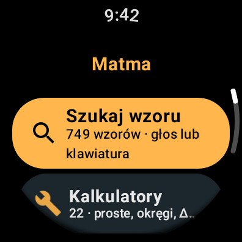 | 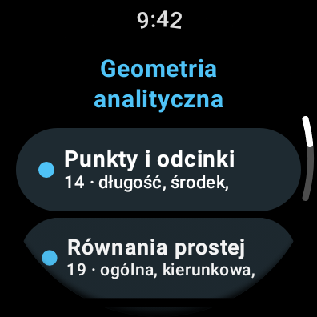 | 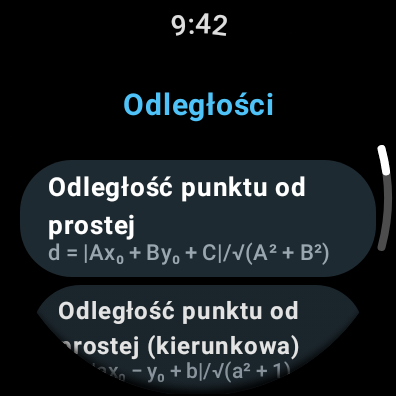 | 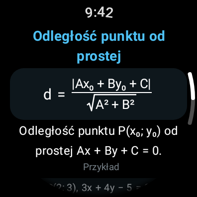 |
| **Kąt między prostymi** | **Pierwiastki** | **Definicja pochodnej** | **Wartości 30°** |
| 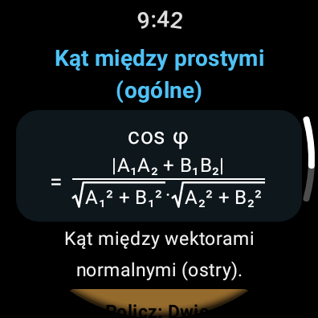 | 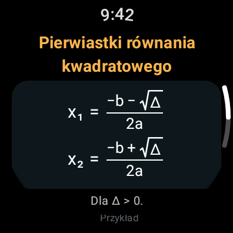 | 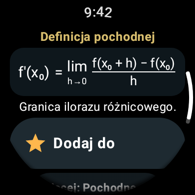 | 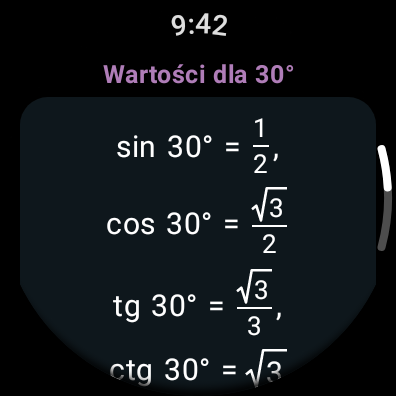 |
| **Kalkulator: punkt–prosta** | **Kalkulator: Δ** | **Kalkulator: trójkąt** | **Klawiatura** |
| 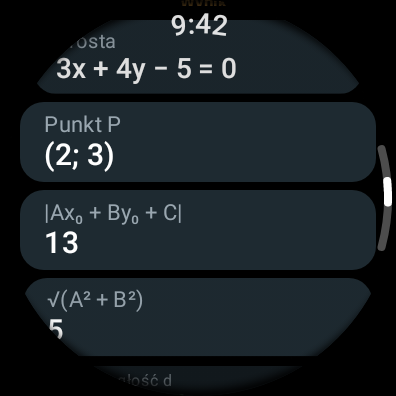 | 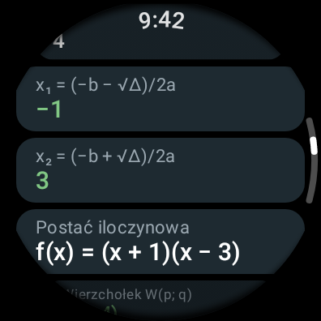 | 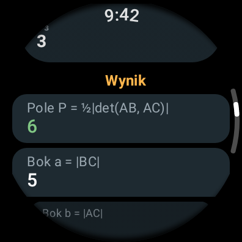 | 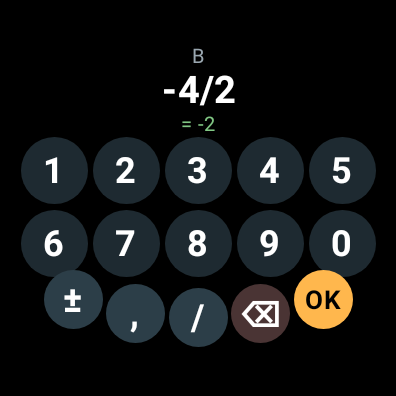 |
| **Bernoulli** | **Całka** | **Szukaj** | **Fiszki** |
| 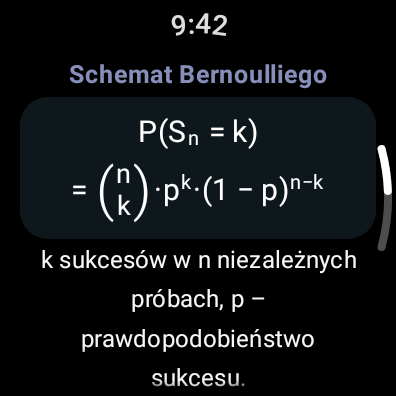 | 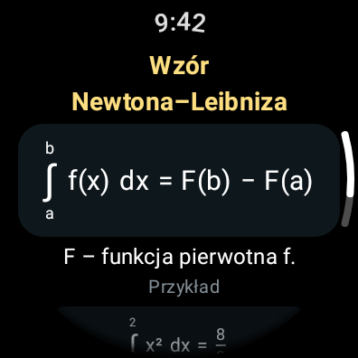 | 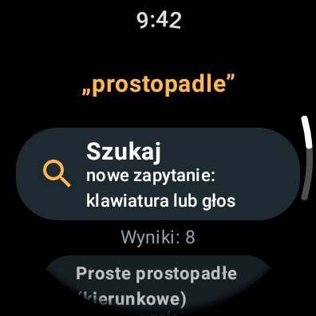 | 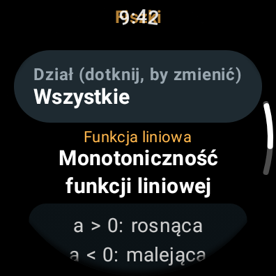 |

## Działy i kategorie

Wzory są rysowane jak w zeszycie: piętrowe ułamki, pierwiastki z kreską, wykładniki, indeksy,
wektory ze strzałką, symbol Newtona, granice, sumy i całki z granicami. Każdy wzór ma opis,
często przykład z liczbami i wskazówkę (💡).

- **Geometria analityczna** (159) – punkty i odcinki (długość, środek, podział w stosunku, pole
  trójkąta z współrzędnych, wzór Gaussa, współliniowość) · **równania prostej** (ogólna, kierunkowa,
  przez 2 punkty, odcinkowa, parametryczna, normalna, wektory normalny i kierunkowy) ·
  **wzajemne położenie prostych** (∥, ⟂, punkt przecięcia, Cramer, kąt między prostymi, symetralna,
  dwusieczne) · **odległości** (punkt–prosta w obu postaciach, proste równoległe, rzut punktu na
  prostą, punkt symetryczny względem prostej, wysokość) · wektory · okrąg w układzie (równania,
  styczne, położenie prostej i okręgów, cięciwa, oś potęgowa) · przekształcenia (symetrie, obroty,
  jednokładność, przesuwanie wykresów) · krzywe stożkowe · geometria analityczna 3D.
- **Funkcje** (107) – własności funkcji, liniowa, kwadratowa (Δ, wierzchołek, postacie, Viète,
  zadania z parametrem), wielomiany (Bézout, Horner), wymierne i homograficzna, wykładnicza,
  logarytmy, wartość bezwzględna.
- **Algebra** (88) – wzory skróconego mnożenia, potęgi i pierwiastki, procenty, średnie,
  podzielność, równania i nierówności, liczby zespolone, macierze i wyznaczniki.
- **Trygonometria** (68) – definicje, tabela wartości, wzory redukcyjne, tożsamości, równania,
  twierdzenia sinusów i cosinusów.
- **Planimetria** (80) – trójkąty (Heron, R, r, środkowe, podobieństwo), trójkąt prostokątny
  i równoboczny, czworokąty, koło i okrąg, wielokąty.
- **Stereometria** (36) – graniastosłupy, ostrosłupy, bryły obrotowe, kule wpisane i opisane.
- **Ciągi** (38) – arytmetyczny, geometryczny, szereg, granice ciągów.
- **Analiza** (83) – granice i asymptoty, pochodne (reguły, tabela, styczna, ekstrema), całki.
- **Kombinatoryka i statystyka** (58) – permutacje, wariacje, kombinacje, prawdopodobieństwo,
  Bernoulli, Bayes, zmienna losowa, średnia, mediana, wariancja, korelacja.
- **Logika, zbiory, stałe** (32).

## Kalkulatory

Liczą na żywo, wyniki podają **dokładnie i w przybliżeniu** (np. `7√13/13 ≈ 1,9415`, `(−3 + √17)/4`, `2/3`):

- **Geometria analityczna:** odległość punktu od prostej (+ rzut, punkt symetryczny, proste ∥ i ⟂
  przez punkt), prosta przez 2 punkty (postacie, |AB|, środek, symetralna), postacie prostej,
  dwie proste (przecięcie, kąt, odległość równoległych), proste ∥ i ⟂ dla y = ax + b,
  trójkąt z 3 punktów (pole, kąty, okręgi opisany i wpisany, ortocentrum), okrąg z równania ogólnego,
  okrąg i prosta (punkty wspólne, cięciwa), dwa okręgi, wektory.
- **Funkcje:** kwadratowa, liniowa, homograficzna, układ równań (Cramer), logarytm i potęga,
  funkcje trygonometryczne kąta.
- **Inne:** trójkąt z 3 boków, ciąg arytmetyczny i geometryczny, kombinatoryka, procent składany,
  średnie dwóch liczb.

Przy wzorze jest przycisk „Policz”, a przy kalkulatorze lista powiązanych wzorów.

## Sterowanie

- **Bezel** przewija listy. **Przesunięcie w prawo** – powrót.
- **Szukaj** głosem lub klawiaturą – bez polskich znaków i po początkach słów („odl pkt prost”).
- **Klawiatura liczbowa** pod okrągły ekran: `±` zmienia znak, `,` – ułamek dziesiętny,
  `/` – ułamek zwykły (np. `2/3`), przytrzymanie `⌫` czyści.
- **Ulubione** (gwiazdka), **ostatnio oglądane**, **fiszki** do nauki (losowy wzór, najpierw tylko nazwa).

## Instalacja na Galaxy Watch 4 Classic

Gotowy plik APK: zakładka **Actions** → ostatni build → artefakt `matma-wear-apk`
(albo zbuduj sam – patrz niżej).

1. Na zegarku: **Ustawienia → Informacje o zegarku → Oprogramowanie** → 7× dotknij
   „Wersja oprogramowania”, aby włączyć opcje programisty.
2. **Ustawienia → Opcje programisty**: włącz **Debugowanie ADB** i **Debugowanie bezprzewodowe**
   (zegarek i komputer w tej samej sieci Wi-Fi).
3. W „Debugowanie bezprzewodowe” wybierz **Paruj nowe urządzenie** i na komputerze:
   ```bash
   adb pair IP_ZEGARKA:PORT_PAROWANIA
   adb connect IP_ZEGARKA:PORT
   ```
4. Zainstaluj:
   ```bash
   adb install -r app-release.apk
   ```
5. Aplikacja **Matma** pojawi się na liście aplikacji zegarka.

## Budowanie

Wymagania: JDK 17+, Android SDK (platforma 35).

```bash
./gradlew :app:assembleRelease   # app/build/outputs/apk/release/app-release.apk
./gradlew testDebugUnitTest      # testy: baza wzorów, kalkulatory, render ekranów (Robolectric)
```

Zrzuty ekranów z testów trafiają do `app/build/screenshots/`.

## Struktura

```
app/src/main/java/pl/matma/wzory/
├── data/content/   # wzory – jeden plik na dział (łatwo dopisywać)
├── data/           # model, baza, wyszukiwarka
├── math/           # zapis wzorów (MathMarkup), kalkulatory, formatowanie dokładnych wyników
└── ui/             # ekrany, renderer wzorów, klawiatura liczbowa
```

### Dopisywanie wzorów

```kotlin
f(
    "Odległość punktu od prostej",                       // nazwa
    "d = @f{|Ax₀ + By₀ + C|}{@s{A² + B²}}",              // wzór
    "Odległość punktu P(x₀; y₀) od prostej Ax + By + C = 0.",
    ex = "P(2; 3), 3x + 4y − 5 = 0 ⇒ d = @f{13}{5}",     // przykład
    calc = "punkt-prosta",                               // powiązany kalkulator
)
```

Zapis: `@f{a}{b}` ułamek, `@s{x}` pierwiastek, `@r{n}{x}` pierwiastek n-tego stopnia,
`^{…}` wykładnik, `_{…}` indeks, `@v{AB}` wektor, `@o{x}` kreska nad, `@b{n}{k}` symbol Newtona,
`@lim{x→0}`, `@sum{dół}{góra}`, `@int{a}{b}`, `@sys{…}{…}` układ równań; dwie spacje rozdzielają
osobne wzory w linii, `\n` – nowa linia.

Min. Wear OS 3 (API 30) – Galaxy Watch 4 i nowsze.
